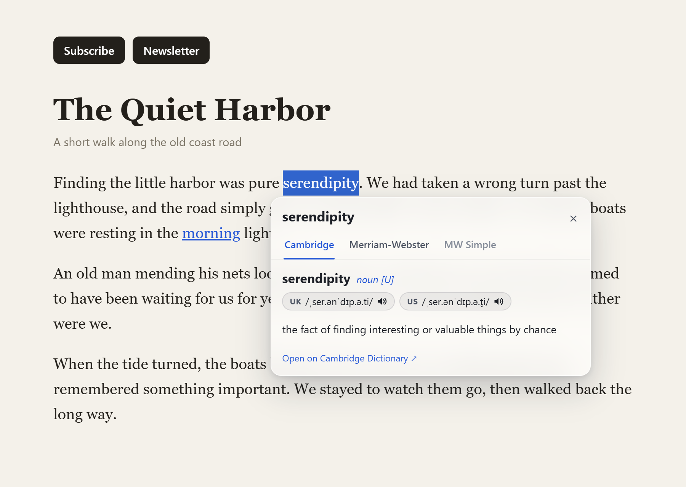
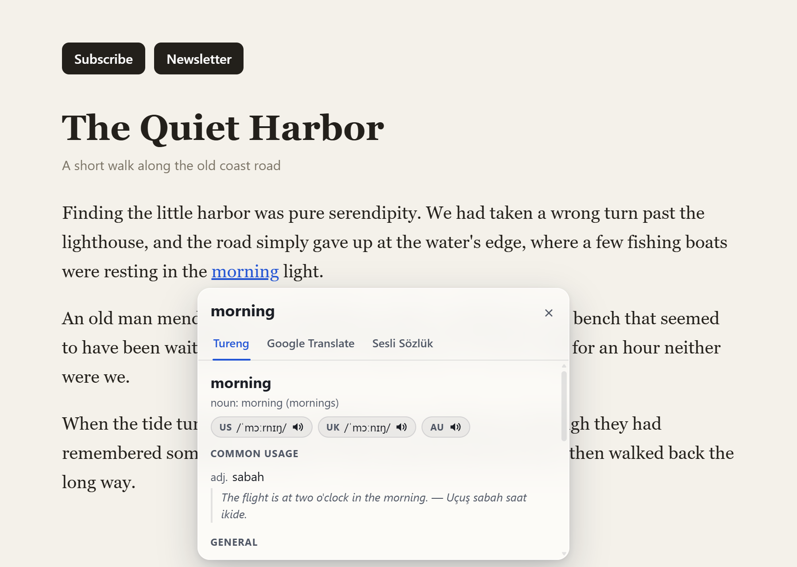

# UWords

Double-click any word on the web, even inside a link or a button, and see what it means in a small popup right next to it.

<p align="center">
  
  
</p>

UWords comes in two editions, each for Chromium browsers (Chrome, Edge, Brave, Opera…) and for the Firefox family (Firefox, Zen):

| Edition | For | Tabs |
|---|---|---|
| **UWords** | English definitions | Cambridge Dictionary · Merriam-Webster · MW Simple (Learner's Dictionary) |
| **UWords TR** | Turkish meanings of English words, and English meanings of Turkish words | Tureng · Google Translate · Sesli Sözlük |

**Status:** version 1.3.0. The automated tests pass on Chrome 156, Firefox 159, Microsoft Edge 156 and Zen 1.24. It isn't in the browsers' add-on stores yet, so you install it from a package or from source.

## Features

**Works on any text**

- Plain text, links, buttons, labels, tabs, menu items, form buttons, and anything else you can click. Double-clicking a link looks the word up without following it; a single click still follows it, after a ¼-second wait to tell the two apart. Don't want the wait? Turn it off in the settings.
- Sites that block text selection, stop click events, or use shadow DOM, modal dialogs or strict security policies.
- **YouTube captions:** hovering a word underlines it, clicking looks it up and pauses the video until you close the popup. Also in fullscreen and on sites that embed YouTube.
- **PDFs:** web PDFs open in a bundled viewer ([pdf.js](https://mozilla.github.io/pdf.js/), same interface as Firefox's) where words work the same way. Downloads are left alone, and you can turn this off.

**Shows what you need**

- Pronunciation with 🔊 audio, inflections, example sentences, CEFR levels (Cambridge)
- Suggestions for misspelled words
- Inflected words find their base form when the source has no entry of their own (*teacher's* → *teacher*; in UWords TR, *walked* → *walk*)
- Move on from inside the popup: click a suggestion, or double-click a word in a definition

**Fits in**

- Right-click a selected phrase → **Look up “give up” with UWords**
- Toolbar button: a search box, an on/off switch, a per-site off switch and the settings
- Settings: trigger (double-click, Alt+click or single click), opening tab, number of examples, light or dark theme
- Esc or a click outside closes the popup. The site's styles can't affect it, and typing in it doesn't trigger the site's keyboard shortcuts.

## Install

Download the package for your browser from the [latest release](https://github.com/ulualtay/UWords/releases/latest), or build it yourself (see [Development](#development)). Each edition has one package per browser family.

Install one edition per browser profile: with both, a double-click opens two popups. If you want both, set one of them to Alt+click.

### Chrome, Edge, Brave and other Chromium browsers

Needs Chrome 128 or newer.

1. Unzip `uwords-<version>-chromium.zip` (or `uwords-tr-…`) into a folder you'll keep. If you built from source, use `dist/uwords-chromium` instead.
2. Open `chrome://extensions` (`edge://extensions` in Edge) and turn on **Developer mode**.
3. Click **Load unpacked** and pick that folder.

Your browser may remind you about developer-mode extensions at startup; that's normal for extensions not installed from a store.

**PDFs on your computer** open directly if the extension is allowed to read them. Unpacked extensions are by default; if yours isn't, the viewer asks you to pick the file, and has a link to the **Allow access to file URLs** switch.

### Zen

Zen doesn't enforce signing, so an unsigned package installs permanently:

1. In `about:config`, set `xpinstall.signatures.required` to **false**.
2. In `about:addons`, click ⚙️ → **Install Add-on From File…** and pick `uwords-<version>-firefox.xpi` (or `uwords-tr-…`).

### Firefox

Regular Firefox only installs add-ons signed by Mozilla, and these packages aren't signed yet. Until then:

- **Firefox Developer Edition, Nightly or ESR:** same steps as Zen.
- **Regular Firefox:** `about:debugging#/runtime/this-firefox` → **Load Temporary Add-on…** → pick the `.xpi`. It's removed when the browser closes.

**PDFs on your computer:** Firefox never lets extensions read local files. The viewer asks you to pick the file once each time, and has a link back to the browser's own viewer.

## Privacy

UWords has no servers, no accounts, no analytics and no tracking.

- When you look up a word, your browser fetches it directly from the sites listed above, with your own cookies for those sites, just as if you opened the page yourself. Nobody else sees the word.
- Settings stay in your browser.
- A PDF opened in the viewer is fetched by your browser from where it already was.

### Why these permissions?

| Permission | Used for |
|---|---|
| Read and change data on all websites | Running on any site you ask it to, and fetching dictionary pages |
| Storage | Your settings |
| Context menus | The right-click lookup |
| Scripting | Reading the selected text when you open the toolbar popup |
| Declarative net request (Chromium), web request (Firefox) | Opening PDFs in the viewer |
| Offscreen (Chromium) | Parsing dictionary pages and playing audio |
| Web navigation (Chromium) | Noticing that a local PDF was opened |

## Limitations

- Browser-internal pages (`chrome://`, `about:`), the add-on stores and reader view don't allow extensions. Use the search box in the toolbar popup there.
- Text drawn on a canvas (Google Docs, some maps) isn't text to the browser, so it can't be looked up. Neither can native dropdown menus, or text added by CSS.
- Text fields are skipped on purpose, so double-clicking still selects a word there.
- On clickable text a double-click belongs to UWords. Where a site has its own double-click there (opening a file in a web file manager, say), use the per-site switch. A replayed single click also isn't "trusted" to the browser, and a rare site may ignore it; the same switch helps.
- PDFs in `<embed>` or `<object>` tags aren't redirected, only those in tabs and iframes.
- UWords reads the sites' web pages, and Google Translate's unofficial public endpoint, rather than official APIs. When a site changes, its tab may break until the parser is updated. A site's bot protection may ask you to open it once in a tab, and Google may limit requests for a while after heavy use; the other tabs keep working.

## Development

You need [Node.js](https://nodejs.org/) 22.2 or newer. There's nothing to install: the project has no npm dependencies.

```bash
git clone https://github.com/ulualtay/UWords.git
```

```bash
npm run build
```

That writes every combination to `dist/`: an unpacked folder (`dist/uwords-chromium`, `dist/uwords-firefox`, `dist/uwords-tr-chromium`, `dist/uwords-tr-firefox`) and a package next to it. Use `node scripts/build.mjs --edition en-tr --platform chromium` for just one.

To develop, load the unpacked folder as above (on Firefox: **Load Temporary Add-on…** → its `manifest.json`), run the build after a change, and press **Reload** on the extension.

### Tests

```bash
npm test
```

```bash
npm run test:e2e -- --browser chromium
```

```bash
npm run test:e2e -- --browser firefox
```

`npm test` runs in Node. The end-to-end tests drive a real browser, found automatically or set with `CHROME_PATH` and `FIREFOX_PATH`, headless and muted, on a local test site with the internet blocked. Add `--live` to look up words on the real sites instead (sparingly: they do rate-limit), `--edition en-tr` for one edition, `--only "text"` for matching scenarios, and `--headful` to watch in a window.

### Where things are

| Path | What |
|---|---|
| `src/` | Shared extension code: click handling, the panel, YouTube, the PDF viewer, the lookup pipeline, the toolbar popup |
| `platforms/` | Per browser family: manifest and background entry point |
| `editions/` | Per edition: sources, parsers, tab list, icons |
| `scripts/` | Build and icon rendering |
| `test/` | Unit and end-to-end tests |
| `docs/` | [Architecture](docs/ARCHITECTURE.md) and [design decisions](docs/DECISIONS.md) |

See also [CONTRIBUTING.md](CONTRIBUTING.md) and the [changelog](CHANGELOG.md).

## License

[MIT](LICENSE) for UWords itself. The bundled pdf.js and its components keep their own licenses: see [THIRD_PARTY_NOTICES.md](THIRD_PARTY_NOTICES.md).

UWords isn't affiliated with or endorsed by Cambridge University Press & Assessment, Merriam-Webster, Tureng, Google or Sesli Sözlük. It contains no dictionary data: definitions and translations come live from those sites, belong to them, and stay under their terms.
