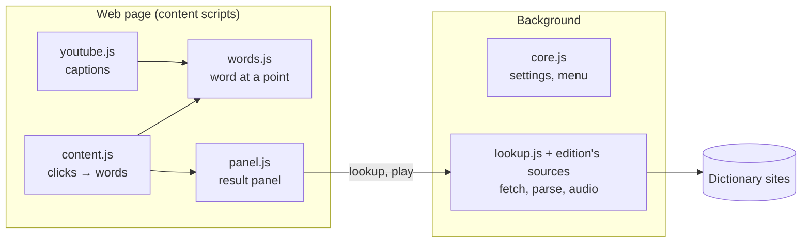
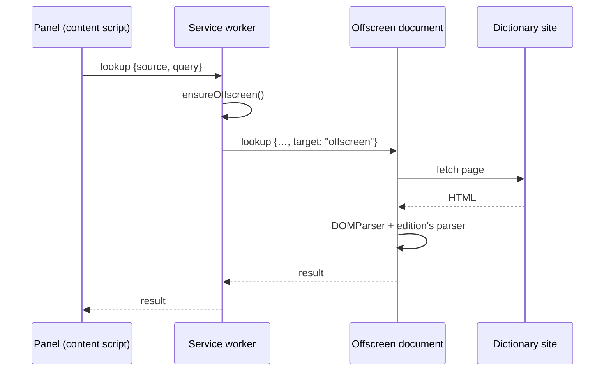
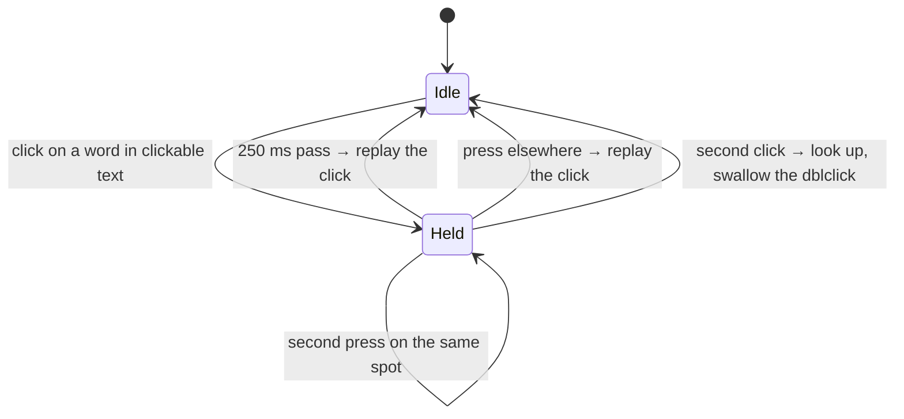

# Architecture

How UWords is put together. For why it is this way, see [DECISIONS.md](DECISIONS.md).

## The big picture

One code base produces four extensions: two **editions** (which dictionaries) times two **platforms** (which browser family).

```
              Firefox, Zen                      Chrome, Edge, Brave…
              Manifest V2                       Manifest V3
UWords        uwords-<version>-firefox.xpi      uwords-<version>-chromium.zip
UWords TR     uwords-tr-<version>-firefox.xpi   uwords-tr-<version>-chromium.zip
```

A build copies three layers on top of each other into `dist/<package>-<platform>/`, and fills in a manifest:

| Layer | Holds |
|---|---|
| `src/` | Everything shared: the panel, click handling, YouTube, the PDF viewer, the lookup pipeline, the toolbar popup |
| `platforms/<platform>/` | What differs by browser: the manifest template and the background entry point |
| `editions/<edition>/` | What differs by dictionary: sources, parsers, tab list, icons, name and description (`edition.json`) |

The build is `scripts/build.mjs`. The version comes from `package.json`. Nothing is compiled: what runs in the browser is the code in the repository.

## Parts and where they run



The panel talks to the background only with messages:

| Message | From → to | Purpose |
|---|---|---|
| `lookup {source, query}` | panel → background | Get one tab's result |
| `play {url}` | panel → background | Play a pronunciation |
| `show {query, screen?}` | background → content script | Open the panel (context menu, or a small frame's word) |
| `show-in-top {query, screen}` | content script → background | "This frame is too small, open it in the top frame" |
| `native-pdf {url}` | viewer → background | The user chose the browser's own viewer for a local PDF |

### The two background designs

The background differs most between platforms, because a Manifest V3 service worker has no DOM.

**Firefox:** a persistent background page (`platforms/firefox/background/firefox.js`). It has a DOM, so lookups run right there.

**Chromium:** a service worker (`platforms/chromium/background/service-worker.js`) that forwards lookups and audio to a hidden [offscreen document](https://developer.chrome.com/docs/extensions/reference/api/offscreen) (`platforms/chromium/offscreen/`):



The worker can be stopped by the browser at any moment, so it registers its listeners at the top level and keeps nothing important in memory. The in-memory lookup cache lives in the offscreen document, which stays alive independently.

`src/background/lookup.js` is the same code in the Firefox page and the offscreen document; `src/background/core.js` is the same code in the Firefox page and the service worker, and must stay free of DOM use.

| Concern | Firefox | Chromium |
|---|---|---|
| API namespace | `browser.*` | `chrome.*`, aliased to `browser` in `common/settings.js` |
| Lookups, audio | background page | offscreen document |
| PDF redirect | blocking `webRequest` | `declarativeNetRequest` rules (`pdf-rules.js`) |
| URL of a redirected PDF | `?src=<encoded url>` | `?src=<raw url>` (a rule can't encode it) |
| Local PDFs detected by | `tabs.onUpdated` | `webNavigation.onCommitted` |
| Reading local PDFs | never allowed: the user picks the file | allowed if "Allow access to file URLs" is on |
| Context menu | created at each start | created once, in `onInstalled` |
| Pausing YouTube | player API, falling back to `<video>` | `<video>` (no access to page objects) |
| Icons | SVG | PNG (rendered by `scripts/render-icons.mjs`, committed) |

## From a click to a word

`src/content/content.js` listens on `window` in the capture phase, from `document_start`. That makes its listeners the first to see an event, so sites can't hide clicks by stopping propagation.

**Finding the word.** `src/content/words.js` works from layout geometry only: it asks what's under the point (`elementsFromPoint`, looking into open and closed shadow roots), then checks the rectangles of the words in those elements' text nodes. It doesn't need the browser to select anything or to place a caret, which fails on links, buttons and `user-select: none`. A few special cases:

- `<input type="submit">` keeps its text out of the DOM, so its words are measured on a canvas.
- The search continues through see-through elements, which finds text under a transparent overlay link, and stops at the first element with a background.
- Text inside `pointer-events: none` wrappers is not in the hit-test stack, so the topmost elements are also searched in depth, within a limit.

On a double-click on ordinary text, the browser's selection supplies the word, since it knows boundaries across inline elements (`W<b>or</b>d`), and geometry supplies the position.

**Clickable text.** A double-click starts with a single click, which would already follow the link or press the button. So when a click lands on a word in clickable text, it is held for 250 ms:



"Clickable" means `a[href]`, `button`, `label`, `summary`, `[onclick]`, the interactive ARIA roles, input buttons, or a computed `cursor: pointer`. Clicks that don't land on a word aren't held, nor are clicks with modifier keys, keyboard activations or clicks made by scripts. The replay is a synthetic `click` on the original target, which browsers treat as a normal activation: links navigate, forms submit, labels toggle.

| Setting `trigger` | Plain text | Clickable text |
|---|---|---|
| `dblclick` (default) | double-click | double-click (held click) |
| `click` | single click | double-click (held click), so links keep working |
| `alt-click` | Alt+click | Alt+click, on `mouseup` because Firefox fires no `click` for it on a link |

`clickableText: false` turns the holding off.

**YouTube captions** (`src/content/youtube.js`) run their own gesture logic on the same geometric word search, and tell `content.js` which events they handle through `uwPage.claimClicks`.

## The panel

`src/ui/panel.js` is one class used in three places: floating on pages, floating in the PDF viewer, and embedded in the toolbar popup. Everything lives in a closed shadow root, so page styles can't reach it.

To be visible and usable anywhere, the panel (`mountPoint`, `bringToTop`):

- is placed inside the topmost modal `<dialog>` if there is one, because the rest of the page is inert then; otherwise inside the fullscreen element, or at the document root
- enters the top layer (`popover="manual"`), which is above every z-index, and above the page's own dialogs and fullscreen elements

Its stylesheet is a constructable stylesheet where possible, which page CSP doesn't apply to, with a `<link>` as a fallback.

A word in a frame too small for the panel (under 300×220) is passed through the background to the top frame.

## The lookup pipeline

`uwLookup(source, query)` in `src/background/lookup.js`:

1. Normalizes the query.
2. Calls the source's `run(query)` from `UW_LOOKUPS` (the edition's `background/sources.js`).
3. If that found nothing usable, tries other forms: the stem of apostrophe words (*teacher's* → *teacher*), and for sources with `baseForms`, English base forms (*walked* → *walk*).
4. Returns the result, with `resolvedFrom` set if another form was used.

A source is `{ run, resolvesVia?, baseForms? }`. Fetches go through `uwFetchDoc` / `uwFetchJson`, which handle timeouts and bot-check pages, and results through the `uwCached` LRU cache.

The panel asks for every tab's result at once, except sources marked `lazy` in the edition's `common/edition.js`, which are asked when their tab is opened. Google Translate is lazy because it rate-limits its public endpoint.

### The result shape

Every parser produces this, and `panel.js` renders it:

```js
{
  status: 'ok' | 'notfound' | 'unavailable' | 'error',
  url,                    // the page on the source's site
  query,                  // the form that was found
  resolvedFrom,           // the original word, if another form was used
  suggestions: [string],  // "Did you mean"
  message,                // for 'error'
  entries: [{
    headword, pos, inflections,
    prons: [{ label, text, audio }],
    collapsed, moreLabel, // secondary material, hidden behind a button
    groups: [{
      title,
      senses: [{
        num, level, labels: [string], phrase, def, lang,
        notes: [string],
        examples: [{ lead, text }],
        subs: [{ label, def, examples }],
        refs: [string],
      }],
    }],
  }],
}
```

Internal to the background, a source may also return `partial: true` ("results, but not for this exact word", which triggers the base-form fallback) and `internal`; neither reaches the panel.

### The sources

| Edition | Source | Fetched from | Format |
|---|---|---|---|
| en | Cambridge | `dictionary.cambridge.org/search/english/direct/?q=<word>` | HTML |
| en | Merriam-Webster | `www.merriam-webster.com/dictionary/<word>` | HTML |
| en | MW Simple | `/simple/<word>`, when the full page links to it | HTML |
| en-tr | Tureng | `tureng.com/en/turkish-english/<word>` | HTML |
| en-tr | Google Translate | `translate.googleapis.com/translate_a/single?client=gtx…` | JSON |
| en-tr | Sesli Sözlük | `www.seslisozluk.net/<word>-nedir-ne-demek/` | HTML |

Pronunciation audio is fetched in the background and only from the hosts in `UW_AUDIO_HOSTS`, so a page can't use the extension to fetch arbitrary URLs.

## PDFs

The bundled viewer is `src/pdfjs/web/uwords-viewer.html` (pdf.js with the UWords scripts added), glued by `src/pdf/viewer-glue.js`:

- `?src=<url>` opens that PDF
- `?local=<file url>` asks the user to pick the file, for local PDFs the extension can't read
- no parameter: the "Open PDF…" page

Web PDFs in tabs and iframes are redirected to it based on their response headers, except downloads (`Content-Disposition: attachment`). Content scripts don't run in extension pages, so the viewer loads them itself as ordinary scripts.

## Tests

| Command | What runs | Needs |
|---|---|---|
| `npm test` | `test/unit/`: normalizing, base forms, PDF rules, the Google parser, and every build combination (manifests, referenced files, zip format) | Node |
| `npm run test:e2e -- --browser chromium` | `test/e2e/`: real browser, real input events, a local test site | a Chromium browser |
| `npm run test:e2e -- --browser firefox` | the same scenarios | Firefox or Zen |
| add `--live` | lookups on the real dictionary sites instead | network |

The end-to-end drivers talk to the browsers directly, over the DevTools Protocol pipe (`test/e2e/lib/cdp.mjs`, `chromium-driver.mjs`) and WebDriver BiDi (`firefox-driver.mjs`), so no npm packages are needed. `test/e2e/lib/server.mjs` is the test site, including generated PDFs. Parser fixtures in `test/e2e/fixtures/parsers/` are hand-written and hold no dictionary content.

Normally the test browser has no internet (a proxy that isn't there), so a test run doesn't send hundreds of requests to the dictionary sites; every double-click would otherwise be three lookups. Google answers such traffic with HTTP 429 quickly. Keep `--live` runs occasional for the same reason.

Live YouTube doesn't render captions in a headless browser, so captions are tested on a mock of the player's markup (`fixtures/youtube.html`).

Test browsers run headless and muted (`--mute-audio`, `media.volume_scale`), because a test run must not disturb the person running it. Only `--headful` opens a window, for debugging. With `--live` on Chromium, the headless browser reports the user agent it would have with a window: the sites' bot protection challenges the headless one, which real users never have.
